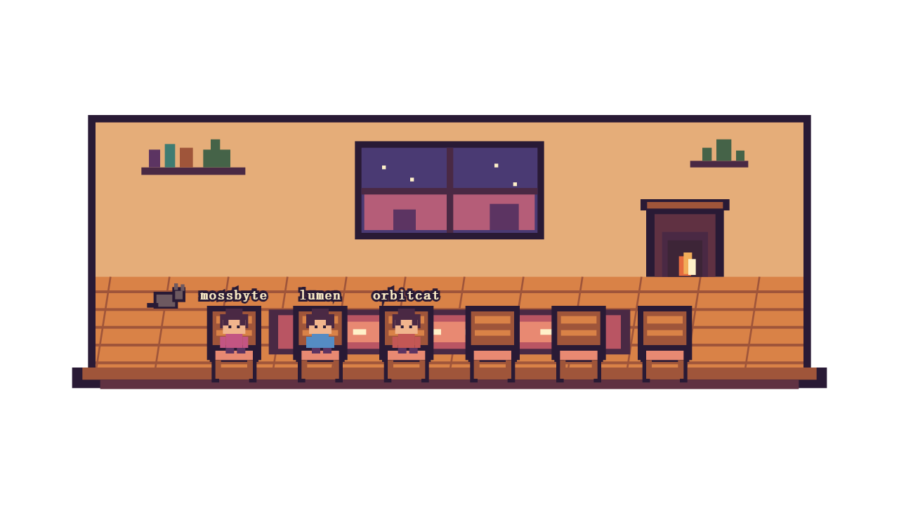
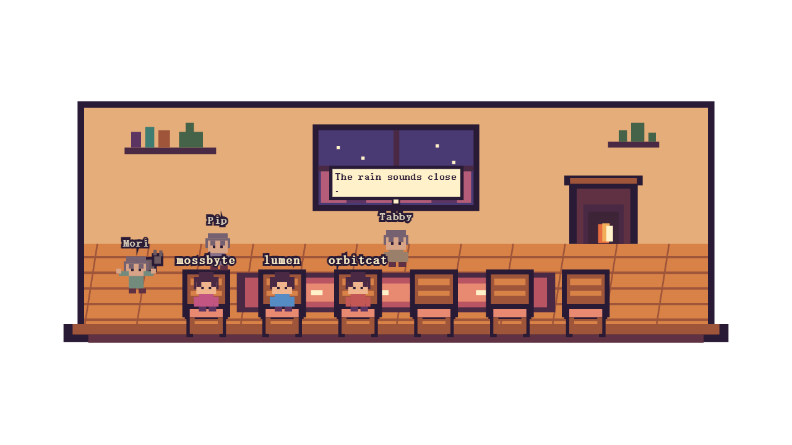

# sitwithme

sitwithme is a transparent OBS browser overlay for the awkward quiet moments in a Twitch stream: viewers can claim a chair in a small pixel room, while a few gentle residents keep the space feeling alive when chat goes silent. It uses Twitch EventSub over WebSocket, a dependency-light TypeScript server, and a single-file Canvas renderer.





## Quick start

Requirements: Node.js 20 or newer and a Twitch account for the bot.

1. Create an application in the [Twitch Developer Console](https://dev.twitch.tv/console/apps). Set its OAuth redirect URL to exactly `http://localhost:3000/callback`, then copy the client ID and client secret.
2. Copy `.env.example` to `.env` and fill in `TWITCH_CLIENT_ID`, `TWITCH_CLIENT_SECRET`, `TWITCH_CHANNEL`, and `TWITCH_BOT_USER`. The bot account must be able to join the channel.
3. Install and start:

   ```sh
   npm install && npm start
   ```

4. On the first run, open `http://localhost:3000/auth` and authorize the bot account. sitwithme requests `user:read:chat`, `user:bot`, and `channel:bot`. The user token is stored in the Git-ignored `.tokens.json` file and refreshed automatically.
5. Open the local control panel at `http://localhost:3000/panel`.

For development with automatic restart, use `npm run dev`.

### Test without Twitch

Set `FAKE_CHAT=1` in `.env`, or launch a PowerShell session with:

```powershell
$env:FAKE_CHAT='1'; npm start
```

Fake chat seats sample viewers, exercises chat bubbles and `!wave`, pauses long enough for idle mode, and never contacts Twitch. For a faster idle-mode demo, use `$env:IDLE_MINUTES='0.25'` before the first launch or set `0.25` in the panel.

## OBS setup

Add a Browser Source with these settings:

- URL: `http://localhost:3000/overlay`
- Width: `1280`
- Height: `720`
- Custom CSS: leave empty; the page is already transparent

Use `http://localhost:3000/overlay?scale=1.5` to zoom the room to 150%. The supported scale range is 0.5–3.

## Commands

| Command | Effect |
| --- | --- |
| `!sit` | Takes the first empty chair. |
| `!leave` | Leaves the viewer's chair. |
| `!wave` | Waves for about 1.5 seconds. |

Normal messages from seated viewers appear in a speech bubble for about four seconds.

## Idle mode

Any human chat message resets the idle timer. After the configured silence, two or three resident characters walk around, sit only in empty chairs, stretch, and exchange short cozy lines. The fireplace flickers and the cat occasionally stretches too. The next human message ends idle mode immediately; residents stop talking and step back within about two seconds.

Use **Test idle now** in the panel to enter idle mode immediately. The panel also has a local fake-`!sit` control for checking the overlay without Twitch.

## Configuration

Panel settings are saved to the Git-ignored `settings.json` file and hot-reload in every connected overlay. Environment values provide first-run defaults; saved panel settings take precedence after that.

| Setting | Default | Description |
| --- | --- | --- |
| `TWITCH_CLIENT_ID` | — | Twitch application client ID. |
| `TWITCH_CLIENT_SECRET` | — | Twitch application client secret. |
| `TWITCH_CHANNEL` | — | Channel login whose chat is observed. |
| `TWITCH_BOT_USER` | channel user | Bot account login used for the EventSub condition. |
| `HOST` | `127.0.0.1` | Listen address. Set explicitly to expose beyond this computer. |
| `PORT` | `3000` | HTTP and local WebSocket port. |
| `CHAIRS` | `6` | First-run chair count, from 2 to 12. |
| `IDLE_MINUTES` | `3` | First-run idle delay; fractional minutes are allowed. |
| `RESIDENTS` | `Mori,Pip,Tabby` | First-run comma list of two or three resident names. |
| `ROOM_PALETTE` | `cozy-orange` | First-run palette: `cozy-orange`, `night-blue`, `forest`, or `candy`. |
| `FAKE_CHAT` | `0` | Set to `1` to run the repeating local fake-chat stream. |
| `SETTINGS_FILE` | `settings.json` | Optional alternate settings path, useful in containers. |
| `TOKEN_FILE` | `.tokens.json` | Optional alternate OAuth token path, useful in containers. |

`GET /api/state` exposes the room, idle state, residents, palette, and effective settings for local debugging. The server binds to loopback by default and the control panel has no authentication; only override `HOST` on a trusted network.

## Docker

Copy `.env.example` to `.env`, fill in the Twitch values, then run:

```sh
docker compose up --build
```

The Compose setup binds port 3000 and stores `settings.json` plus the OAuth token file in a named volume.

## Built with Codex

Built with OpenAI Codex for the Codex x TwitchCon Hackathon 2026.

Codex thread: TBD

## License

[MIT](LICENSE) © sitwithme contributors
